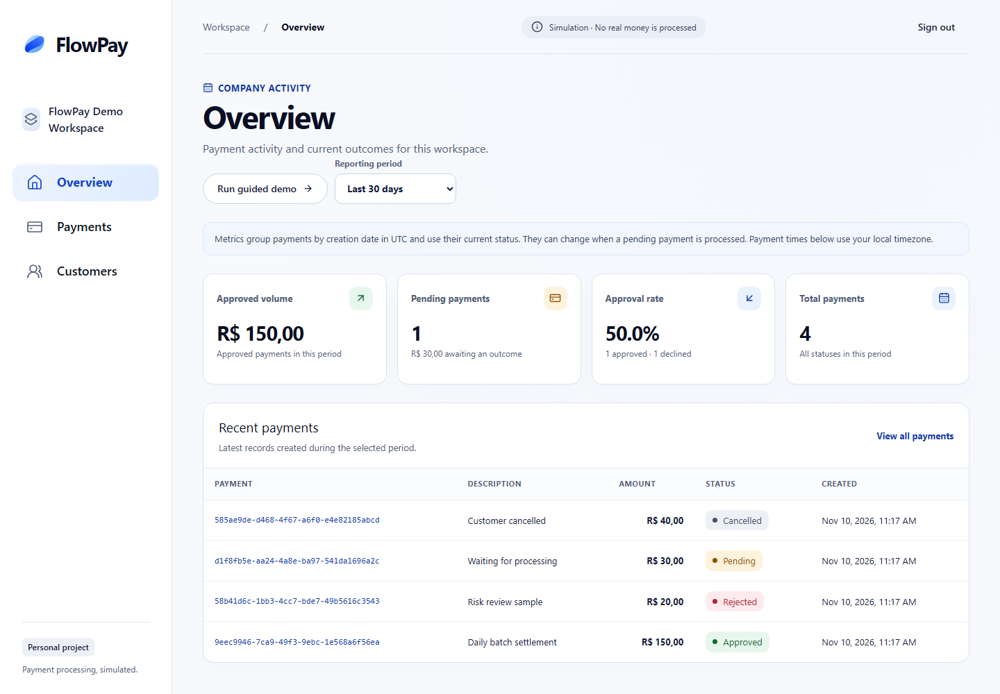
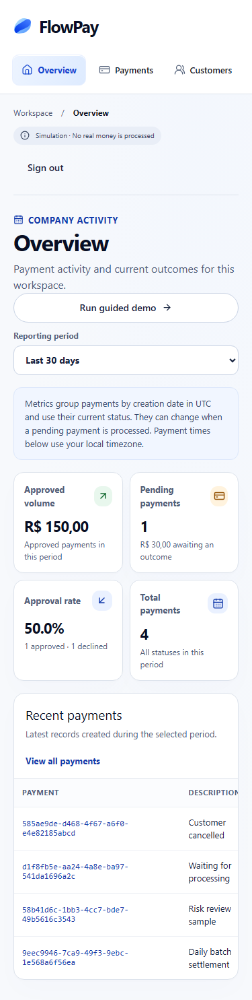

# FlowPay

**A Java payment-processing simulation built as a personal portfolio project.** It demonstrates payment idempotency, PostgreSQL transactions, tenant isolation, session security and a browser interface connected to a real API. It never moves money or collects card or bank credentials.

> Local project, not a financial service. The demo uses synthetic data.

## What it demonstrates

- Java 21 and Spring Boot modular monolith backed by PostgreSQL 18.
- Atomic payment creation and exact replay of the original response after a lost response or duplicate request.
- Explicit payment state transitions with immutable event history and PostgreSQL row-lock arbitration.
- Session authentication, CSRF-protected writes and company-scoped access.
- React, TypeScript and Vite dashboard using the real API, including a guided replay walkthrough.
- PostgreSQL integration tests, browser acceptance checks and reproducible local performance reports.

This is a personal project, separate from professional employment history. It is intended to make engineering decisions and verification easy to inspect and discuss in an international junior Java interview.

## See the interface

The screenshots below come from the local integrated browser acceptance run. The overview contains synthetic demo data.

| Desktop | Mobile |
|---|---|
|  |  |

## Run locally

Requirements: Docker Desktop with its Linux engine and Docker Compose; Node 24.18.0 and npm 11.16.0 for frontend work; Java 21 for backend work. On Windows PowerShell, from the repository root:

```powershell
.\scripts\setup-local.ps1
docker compose up --build --detach --wait
```

The setup script creates an ignored `.env` containing a random local database password and preserves an existing `.env`. Do not commit it. The application binds to loopback at `http://127.0.0.1:8080`.

1. Open [FlowPay](http://127.0.0.1:8080/login) and choose **Explore demo workspace**.
2. Visit Overview and choose **Run guided demo**.
3. Create a synthetic payment, replay the exact request, then process it and inspect the event history.

The demo creates an isolated synthetic company with seeded customers/payments. Demo workspaces expire after 24 hours and are cleaned up. No shared password or public conventional signup exists. For operator provisioning and platform-specific setup, see [local development](docs/development/local-development.md).

After the stack is running, browse the verified read-only [API docs](http://127.0.0.1:8080/api/docs) or [OpenAPI contract](http://127.0.0.1:8080/api/openapi.yaml). These are local links; no public demo or API URL exists.

Stop containers while preserving local data with `docker compose down`. Do not add `--volumes` unless you intentionally want to erase this project's local database.

## Verify changes

Backend, from the repository root in PowerShell:

```powershell
. .\scripts\use-java.ps1
Push-Location backend
.\mvnw.cmd -B verify
Pop-Location
```

Frontend, from the repository root:

```powershell
Push-Location frontend
npm ci
npm run lint
npm run typecheck
npm test
npm run build
npm run test:e2e
Pop-Location
```

PostgreSQL-backed backend integration tests use Testcontainers and need Docker. The browser suite targets the local Compose app; see [integrated acceptance evidence](docs/verification/product-acceptance.md) for its rate-limit setup and exact coverage. The GitHub Actions workflow is configured but has not been run remotely.

## Architecture and evidence

FlowPay is one Java application with `company`, `identity`, `customer` and `payment` modules, one PostgreSQL database, and a React SPA served through a same-origin Nginx proxy in the local Compose environment. The Java API owns authorization, monetary rules, payment transitions, idempotency and dashboard metrics.

Payment creation reserves a company-scoped idempotency key, writes a `PENDING` payment, creation event and original response in one transaction. Reusing the same key and request returns the original status/body and ID, plus a replay indicator; changing the request with that key returns a conflict. Processing or cancellation locks and rechecks the payment, then commits the final state and next event together. See [architecture](docs/architecture.md), [ADR 0003](docs/adr/0003-idempotent-creation.md) and [ADR 0004](docs/adr/0004-payment-locking.md).

| Evidence | What it establishes | Limits |
|---|---|---|
| [Backend acceptance](docs/verification/backend-acceptance.md) | 114 backend tests, including PostgreSQL 18.6 integration coverage | Local verification; no remote CI run |
| [Integrated browser acceptance](docs/verification/product-acceptance.md) | 12 browser journeys, with the rate-limit case verified separately | Local Compose/browser only; see report for untested behavior |
| [API performance baseline](docs/performance/api-baseline.md) | k6 smoke, reads, mixed and transition-conflict profiles against the real API/database | One local run per profile; directional evidence, not capacity |
| [Frontend performance baseline](docs/performance/frontend-baseline.md) | 18 authenticated Lighthouse audits: three screens × mobile/desktop × three runs | Local lab metrics; no real-user INP, warm-cache or production claim |

The overview measurements currently point to mobile LCP and unused-JavaScript investigation, and a desktop payment-list layout-shift investigation. No before/after improvement is claimed.

## Project map

```text
backend/    Java API, migrations and PostgreSQL integration tests
frontend/   React/TypeScript SPA, unit tests and Playwright journeys
infra/      Same-origin Nginx proxy
performance/ Reproducible k6 and Lighthouse tooling/evidence
scripts/    Local setup, verification and provisioning helpers
docs/       Specification, architecture, ADRs, guides and evidence
compose.yaml  Local PostgreSQL, Java, proxy and one-shot bootstrap services
```

Start with the [documentation index](docs/README.md), [implementation status](docs/implementation-status.md), [guided demo](docs/demo-walkthrough.md), or [interview notes](docs/interview-notes.md). Deployment requirements and limits are in [deployment notes](docs/deployment.md); FlowPay has not been publicly deployed.
