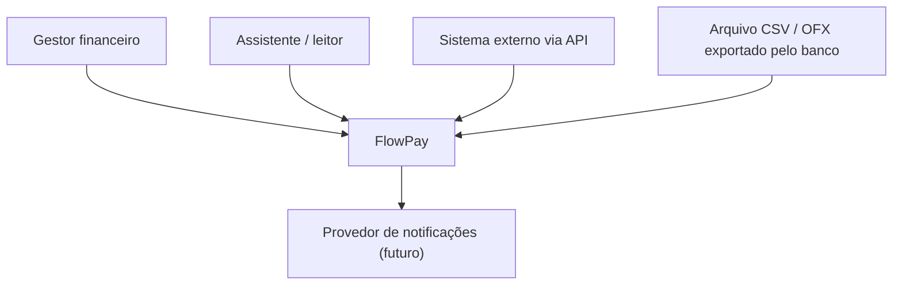
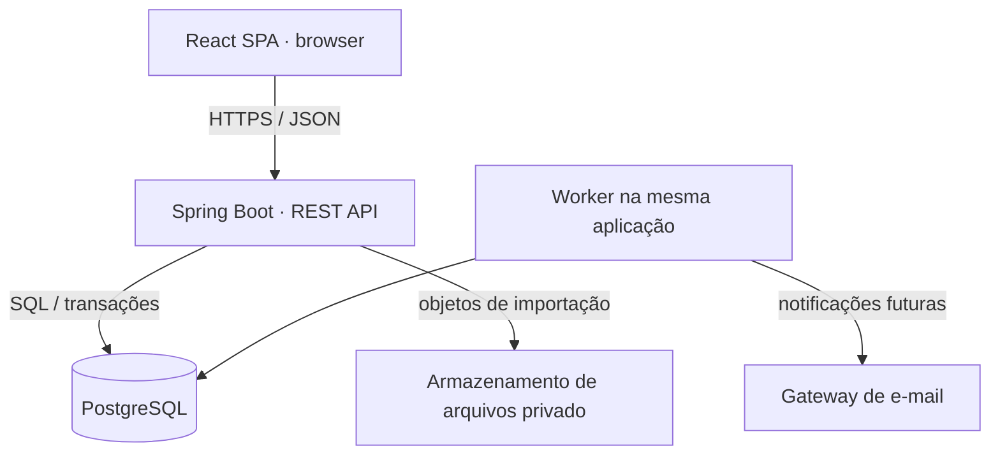
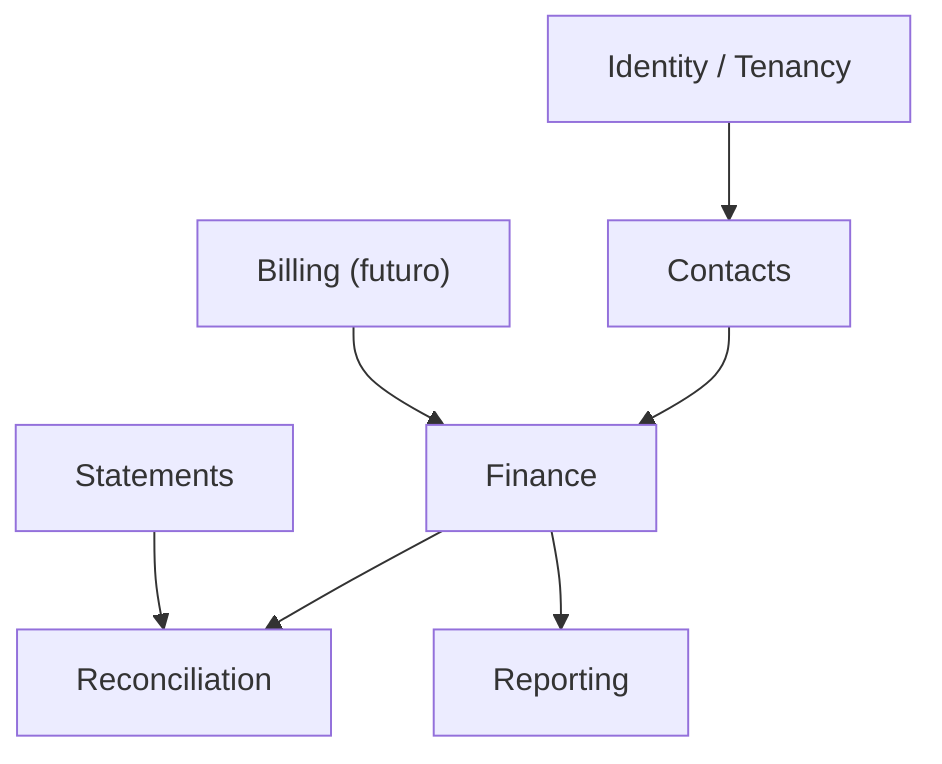
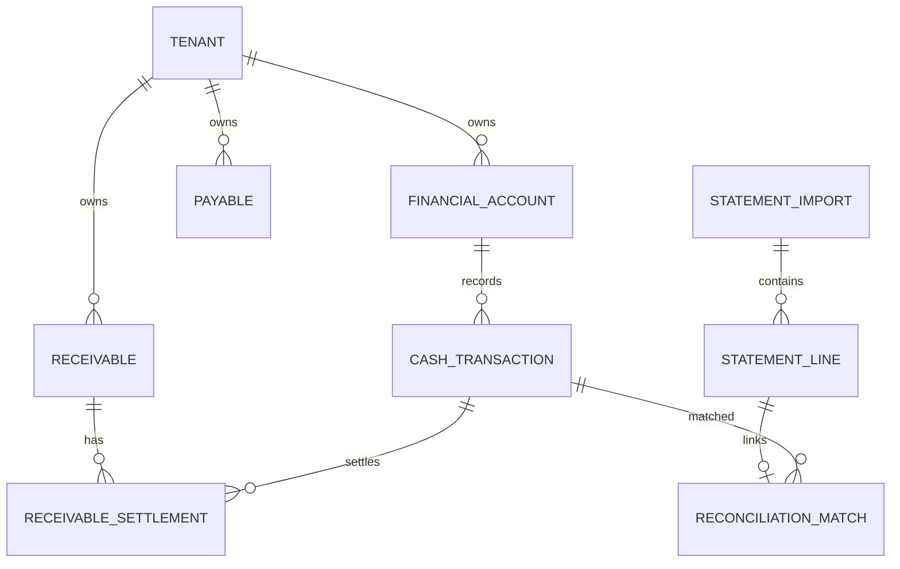
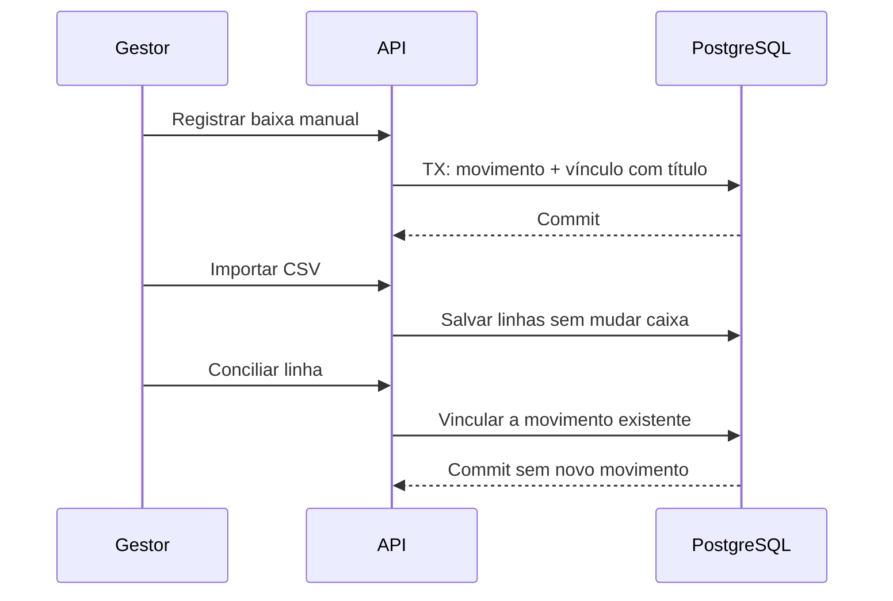

# FlowPay — System Design (v1.0)

**Status:** proposta arquitetural para revisão · **Data:** 18/11/2026  
**Produto:** SaaS de gestão financeira para pequenas prestadoras de serviços brasileiras  
**Referência:** FlowPay PRD v3.0 · **Escopo:** MVP financeiro e evolução modular, sem movimentação bancária real

## 1. Decisão arquitetural

**Recomendação: monólito modular + frontend SPA + PostgreSQL + workers internos.** O produto precisa de transações confiáveis entre contas, baixas, importação e conciliação; dividir isso em microsserviços agora adicionaria comunicação distribuída a operações que se beneficiam de um único commit no banco.

| Abordagem | Vantagens | Riscos | Decisão |
|---|---|---|---|
| Monólito em camadas por controller/service/repository | Começo rápido | Domínios se misturam e ficam difíceis de testar isoladamente | Não recomendado |
| **Monólito modular orientado por domínios** | Transações locais, modularidade verificável, baixo custo operacional | Exige disciplina nos contratos entre módulos | **Escolhido** |
| Microsserviços desde o início | Escalabilidade e deploy independentes | Consistência distribuída, rede, observabilidade e operação complexas | Adiar até existir necessidade medida |

O **Spring Modulith** é uma opção para verificar dependências entre módulos e produzir documentação de sua estrutura; sua documentação oficial descreve validação de ciclos e acesso a interfaces expostas. Adotar após o núcleo estar organizado, sem converter o projeto em uma arquitetura de eventos artificial. [Spring Modulith — verificação](https://docs.spring.io/spring-modulith/reference/verification.html)

## 2. Requisitos e cargas iniciais de projeto (hipóteses)

**Não são números medidos nem promessas:** iniciar com até 100 empresas demo, 10 usuários por empresa, 100 mil movimentações totais e importações CSV de até 10 MB / 50 mil linhas por arquivo. Operações financeiras exigem integridade antes de throughput. Após testes, registrar p95 de leitura, tempo de importação, concorrência e uso de recursos; ajustar limites por evidência.

Requisitos invariantes: isolamento por tenant; valores inteiros em centavos; histórico auditável; nenhuma duplicação de caixa por reimportação; baixas não podem exceder saldo de título; sandbox PSP separado do acompanhamento real; disponibilidade de dados por backup e restauração demonstráveis.

## 3. C4 — Contexto



**Limite de confiança:** arquivos bancários são entrada não confiável e **não representam integração bancária direta**. O usuário importa um documento que pode conter dados sensíveis; o FlowPay não inicia transações em bancos. O mock PSP, quando existir, será explicitamente simulado.

## 4. C4 — Containers



**MVP local:** os arquivos podem ficar em storage local privado com metadados no PostgreSQL; para deploy, adotar armazenamento de objetos com controle de acesso e expiração. Não guardar uploads em diretório público. SPA pode ser servida por servidor estático/proxy HTTPS; API não precisa conhecer a estrutura React.

## 5. Módulos e contratos

| Módulo | Responsabilidades | Pode depender de |
|---|---|---|
| `identity` | Tenant, memberships, papéis, sessão/API key | Shared/security |
| `contacts` | Clientes e fornecedores | Identity API |
| `catalog` | Serviços, contratos (fase posterior) | Contacts API |
| `finance` | Contas, títulos, baixas, caixa, categorias | Identity + Contacts APIs |
| `statements` | Upload, parsing CSV/OFX, preview, deduplicação de linhas | Identity + storage |
| `reconciliation` | Sugestões, aprovação e reversão de vínculo | Finance + Statements APIs |
| `billing` | Faturas, planos e assinaturas (posterior) | Contacts + Finance APIs |
| `reporting` | Dashboards, agregações, exportação | Read models de Finance/Billing |
| `audit-events` | Auditoria, outbox e processamento de tarefas | Interfaces estáveis comuns |
| `sandbox-payments` | Mock PSP, ledger e settlement fictícios (posterior) | Infra própria, sem baixa em Finance real |



**Regra de fronteira:** módulos não importam `entity` ou `repository` uns dos outros; usam interfaces e DTOs públicos. Dependências de leitura para `reporting` são contratos versionados, não consultas improvisadas às tabelas internas. Verificação de arquitetura por testes (Spring Modulith/ArchUnit), com falha no CI se houver dependência circular.

### Organização do backend

```text
com.flowpay
  shared/                 # errors, Money, TenantContext, clock
  identity/               # api, application, domain, infrastructure
  contacts/
  finance/
  statements/
  reconciliation/
  reporting/
  audit/
  billing/                # futuro
  sandboxpayments/        # futuro isolado
```

Em cada módulo: `api/` recebe/valida requests; `application/` coordena casos de uso e transações; `domain/` contém regras e estados; `infrastructure/` persiste e integra; DTOs públicos evitam serializar entidades JPA. Não aplicar event sourcing ao MVP.

## 6. Modelo de dados essencial



**Chaves e índices:** UUID por entidade; `tenant_id` em toda tabela empresarial, inclusive na chave composta/index para queries críticas; `version` para alterações concorrentes; índice por status/vencimento; unicidade de `(tenant_id, financial_account_id, file_checksum)` na importação; match ativo único por `statement_line_id`; idempotência escopada por `(tenant_id, operation, key)`. **Integridade no banco:** relacionamentos financeiros usam FKs compostas `(tenant_id, resource_id)` apontando para UNIQUE correspondente, impedindo associação entre tenants mesmo que o serviço cometa erro de filtro.

**Money:** guardar `amount_minor` positivo como `BIGINT` com limites definidos; `direction=INFLOW|OUTFLOW` separado do valor, `currency=BRL`. Consultas financeiras sempre retornam período, timezone e `as_of`. Datas de vencimento são `LocalDate` do negócio; data real de lançamento é `Instant` UTC.

## 7. A operação mais importante: evitar caixa duplicado



**Fonte de verdade:** `CashTransaction` é o único fato que altera **saldo controlado**. `ReceivableSettlement` e `PayableSettlement` representam quitação e referenciam uma ou mais movimentações. `StatementLine` é evidência externa, mas **não altera saldo** quando apenas importada. Ao confirmar conciliação, criar novo movimento **ou** vincular a um existente, nunca ambos inadvertidamente.

Transferência entre contas próprias é registrada por um fato `CashTransfer` e duas `CashTransaction` pareadas (saída da origem e entrada no destino), na mesma transação PostgreSQL. A chave idempotente pertence ao tenant; as duas pernas compartilham valor, data e descrição sob FK composta. O saldo de cada conta muda, o saldo consolidado da empresa não, e os relatórios operacionais excluem as pernas de entradas/saídas e totais por categoria.

**Concorrência:** bloquear o título financeiro (`SELECT FOR UPDATE`) antes de registrar baixas concorrentes; validar `sum(baixas válidas) <= valor original`; unique constraint garante match ativo único por linha; transação atômica grava mudança, auditoria e outbox. Reversão é explícita e não apaga registros confirmados.

**Alocação parcial:** uma movimentação pode quitar mais de um título, mas `sum(alocações ativas) <= amount_minor da CashTransaction`; o valor não alocado permanece reconhecido no caixa com categoria `não classificado`/pendente e pode ser alocado depois. Para conciliação parcial, a primeira versão exige que uma linha do extrato represente uma movimentação completa; múltiplas linhas para um mesmo movimento e match parcial entram em evolução posterior, com contrato explícito de valores e invariantes.

**Saldos no UI:** `saldo controlado` (saldo inicial + movimentos reconhecidos) e `saldo do extrato` (quando fornecido pelo arquivo) são valores distintos. Mostrar diferença pendente de conciliação; não afirmar que são o saldo bancário em tempo real.

**Implemented (2026-11-24):** the authenticated session lists memberships. The SPA requests an active company through `X-FlowPay-Tenant`; every business request resolves that ID together with the authenticated identity and membership. The header is only a selection hint and never an authorization credential. Requests without a selection fail closed for identities with multiple memberships.

## 8. Segurança e falhas

| Risco | Controle | Teste |
|---|---|---|
| ID de outro tenant | `TenantContext` obrigatório + consultas por tenant, autorização em aplicação | IDOR horizontal em todas as APIs |
| Sessão roubada / CSRF | Cookie de sessão HttpOnly, Secure/SameSite; token CSRF válido em mutações, logout/revogação | Requisição sem CSRF rejeitada |
| Upload malicioso | Limites de tamanho/linha, parser sem execução de comandos, armazenamento privado, sanitização de export CSV | CSV formula injection, encoding e datas ambíguas |
| Dupla baixa | Lock + idempotência + constraints | Duas threads tentando quitar mais que saldo |
| Crash após commit | Outbox persistente + retry idempotente | Worker reiniciado não duplica efeito |
| Segredo em logs | Redação de PII/tokens, log com correlation ID | Teste de redaction |

**Ciclo de vida de extratos:** apenas membros autorizados podem baixar originais; registrar auditoria de download; definir política de retenção configurável antes do deploy (proposta inicial: 90 dias para arquivo bruto, metadados/auditoria por prazo distinto conforme política definida), possibilidade de exclusão segura e tratamento de encerramento de tenant. A política final deve ser revisada para privacidade e obrigações aplicáveis antes de uso com dados reais.

**Nota de implementação:** Spring Security documenta considerações especiais para CSRF em SPAs; implementar sessão/cookie e CSRF como fluxo integrado, não desabilitar proteção apenas para facilitar o frontend. [Spring Security CSRF](https://docs.spring.io/spring-security/reference/servlet/exploits/csrf.html)

## 9. Jobs, eventos e consistência

- `OutboxEvent` gravado no mesmo commit local de fatos financeiros relevantes; worker busca eventos pendentes com claim/lock, tenta entrega e registra status/tentativas.
- Importação pequena pode ser transacional com prévia + confirmação; importação grande passa a job persistido com estado `RECEIVED → VALIDATING → READY_FOR_REVIEW → IMPORTED` ou `FAILED`, retries idempotentes.
- Eventos internos como `receivable.settled`, `statement.imported`, `reconciliation.matched`, `invoice.issued` podem alimentar notificações e projeções, mas a fonte da verdade permanece no banco transacional.
- Garantia declarada: *at least once* para entrega assíncrona, efeitos deduplicados por consumer/event ID. Não afirmar *exactly once* distribuído.
- O mock PSP, ledger e settlement fictícios podem evoluir depois sem impactar o `REAL-TRACKING` da empresa.

## 10. Deploy, observabilidade e crescimento

**Ambiente local:** frontend + API + PostgreSQL por Docker Compose; testes Spring/JUnit com Testcontainers, Vitest e Playwright. CI com testes de backend/Frontend, migrations e análise estática. **Produção eventual:** HTTPS e domínio, segredo em secret manager, banco gerenciado, backup/restauração testados, object storage privado, estratégia de migração expand/contract.

**Métricas:** p50/p95 API, duração das importações, pendências de conciliação, tentativas de outbox, falha de jobs, vazão e lock contention; logs estruturados com `request_id` e IDs opacos. Não usar `tenant_id`/`payment_id` como labels de alta cardinalidade em métricas.

**Quando extrair serviço:** somente depois de evidência de necessidades independentes de deploy, ownership, escala e limites transacionais. Primeiro separar por API de módulo. Kafka, Kubernetes, Redis e CQRS não são pré-requisitos.

## 11. ADRs e testes de arquitetura

| ADR | Decisão a registrar |
|---|---|
| 001 | Monólito modular por domínio e banco único |
| 002 | `CashTransaction` como única fonte de saldo controlado |
| 003 | Conciliação explícita com evidência imutável de extrato |
| 004 | Session cookie + CSRF para SPA e scopes futuros para API keys |
| 005 | Separação rígida entre dados reais controlados e sandbox financeiro |
| 006 | Outbox PostgreSQL antes de broker externo |

**Testes de arquitetura:** fronteiras de módulos sem ciclos, proibição de dependência a repositories internos, tenants nas queries, migrações Flyway reexecutáveis, invariantes de saldo e importação, recuperação de workers e testes E2E da jornada mensal.

## 12. Roadmap de arquitetura

1. **MVP utilizável:** identidade, contatos, financeiro, CSV, conciliação, dashboard e relatórios.
2. **Billing:** faturas, contratos, assinaturas, notificações.
3. **Importação avançada:** OFX, jobs grandes, reprocessamento e relatórios de erro.
4. **Payment sandbox:** mock PSP, operações incertas, dupla entrada, settlement e reconciliação PSP, sempre isolados.
5. **Escala mensurada:** otimizar SQL/índices, introduzir cache ou broker somente diante de gargalo provado.

## 13. Referências que orientaram o desenho

- [C4 Model — visão oficial](https://c4model.com/introduction): contexto, containers e componentes para comunicar arquitetura.
- [Spring Modulith](https://docs.spring.io/spring-modulith/reference/verification.html): validação de dependências entre módulos.
- [Spring Security — CSRF](https://docs.spring.io/spring-security/reference/servlet/exploits/csrf.html): particularidades de SPA e sessão.

**Status:** desenho proposto para revisão. Nenhum deploy real, banco ou integração bancária foi criado por este documento.
