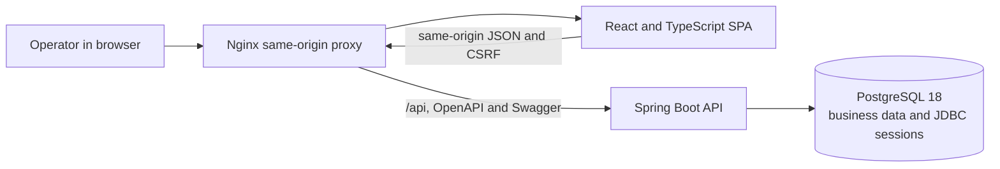
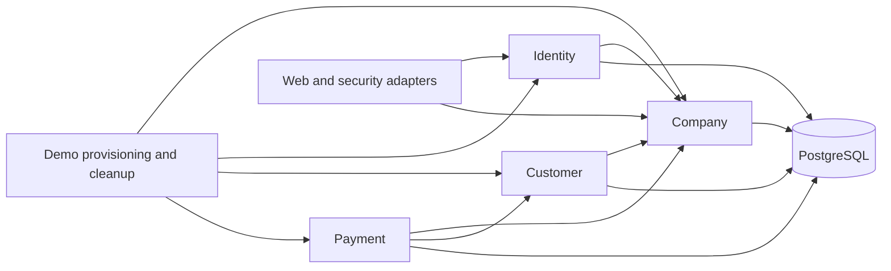
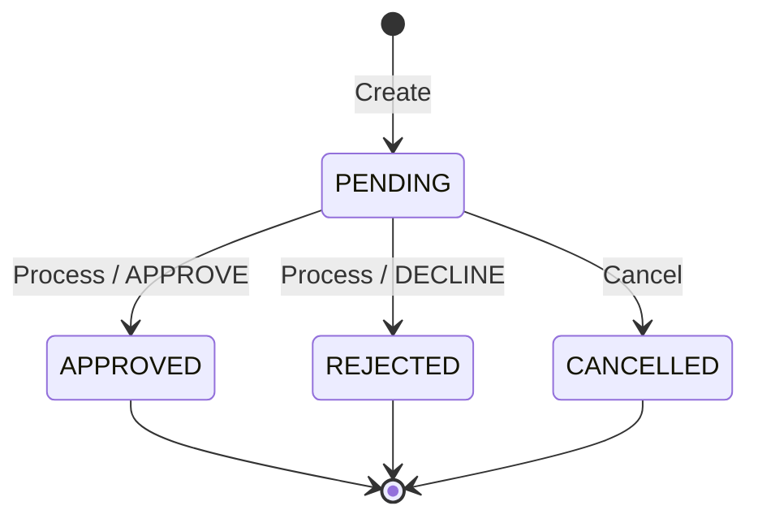

# FlowPay architecture

FlowPay is a local, personal payment simulation. The implemented system is a Java modular monolith, PostgreSQL and a React SPA. The browser and API are served on one origin through Nginx in the Compose environment. No real money, card data or bank credentials are handled. This page summarizes the code and implemented behavior; see the [specification](specs/2026-11-08-flowpay-portfolio-design.md) for full contracts and [implementation status](implementation-status.md) for evidence and limits.

## System context



The proxy serves the built frontend and forwards API and documentation paths. Java is the authority for authentication, company scope, amount validation, payment state, idempotency and aggregate metrics. The frontend provides validation and feedback, but cannot grant access or declare a payment successful without the API response.

## Runtime and modules

| Layer | Implemented choice |
|---|---|
| Backend | Java 21, Spring Boot 4, Spring Web/Security, Spring Session JDBC, Spring Data JPA and JDBC, Spring Modulith, Maven Wrapper |
| Persistence | PostgreSQL 18 and Flyway; UUIDs, relational constraints and indexes |
| Frontend | React, TypeScript, Vite, React Router, TanStack Query and Tailwind CSS |
| Local delivery | Docker Compose and same-origin Nginx reverse proxy |
| Verification | JUnit/Mockito, PostgreSQL Testcontainers, Modulith architecture tests, Vitest and Playwright; k6 and Lighthouse are measurement tools, not runtime dependencies |

Java packages/modules are `company`, `identity`, `customer` and `payment`. Their public APIs carry immutable commands and views; each module's implementation and persistence details remain in internal packages. Identity, customer and payment depend on the company API; payment also depends on the customer API. Web/security adapters and demo provisioning sit outside domain modules. Spring Modulith tests guard against cycles and internal-package access.



Controllers translate HTTP; application services coordinate use cases and transactions; domain rules constrain valid transitions; PostgreSQL constraints and locks enforce integrity under concurrent requests. SQL/JDBC and JPA are both used where appropriate. JPA entities and repositories are not inter-module contracts.

## Payment creation and replay

```mermaid
sequenceDiagram
    actor Client
    participant API as Spring API
    participant DB as PostgreSQL
    Client->>API: POST payment + CSRF + Idempotency-Key
    API->>API: Authenticate, scope company, validate/canonicalize
    API->>DB: READ COMMITTED transaction; reserve unique company/operation/key
    alt New key
        API->>DB: Insert PENDING payment + event + original 201 response
        DB-->>API: Commit all writes together
        API-->>Client: 201 Created + Location
    else Existing key, same canonical request
        API->>DB: Read committed key/hash/original response
        API-->>Client: Original 201 body and ID + Idempotency-Replayed
    else Existing key, different request
        API-->>Client: 409 IDEMPOTENCY_KEY_REUSED
    end
```

The idempotency row has a unique `(company_id, operation, key)` constraint. PostgreSQL `INSERT ... ON CONFLICT DO NOTHING` arbitrates concurrent reservations. The next statement under READ COMMITTED reads the winner's committed value. A matching hash replays stored JSON and status; a different hash returns `409`. Reservation, payment, initial event and original response share one transaction, so an error rolls them all back. The frontend demo keeps the original key and request snapshot in memory; it does not simulate a successful replay locally.

## State and concurrency



Processing and cancellation select the payment by both ID and authenticated company, lock the row with `FOR UPDATE`, and recheck `PENDING`. The status update and next immutable event are committed in one transaction. A concurrent loser sees a final state and receives `409 PAYMENT_FINAL_STATE`. For demo writes and cleanup, the company lock comes before the payment lock to preserve quota/expiry correctness. Short database lock timeouts return a retryable `503`; they are not claimed as successful operations.

Money is BRL only. Java uses `BigDecimal`, PostgreSQL stores `NUMERIC(19,2)`, and the API transmits decimal strings. Values are validated rather than silently rounded. A deterministic `APPROVE` or `DECLINE` scenario turns processing into `APPROVED` or `REJECTED` respectively; no external processor is called.

## Identity and isolation

Browser authentication uses an opaque server session persisted by Spring Session JDBC. The session cookie is HttpOnly and SameSite=Lax; production configuration requires Secure over HTTPS. Writes, including login and demo entry, require a CSRF token. The API derives company/user identity from the authenticated server principal, not from request-body or route claims. Reads and mutations are company-scoped; foreign object IDs are reported as not found.

The local demo provisions an isolated synthetic company, operator, customers and payments in a transaction. Demo operators have no password login. Active company, quota and expiry checks are server-side. Demo workspaces expire after 24 hours and a scheduled cleanup removes their sessions and data. These controls are implemented and locally tested; they do not establish a public multi-tenant service or deployment readiness.

## Dashboard and reads

Payment list, detail and immutable event-history reads use company scope and pagination. Dashboard metrics are computed by the API from database aggregates and the authenticated company; monetary outputs preserve decimal-string precision. The React app uses TanStack Query for server state and invalidates related payment/history/dashboard queries after mutations. It does not calculate money with JavaScript floating-point arithmetic.

## Alternatives and consequences

The project uses a modular monolith instead of microservices. One deployable Java process and one relational transaction boundary make idempotency, history and state changes straightforward to demonstrate. Module APIs and architecture tests preserve internal boundaries. This avoids network failure handling, distributed transactions and extra deployment systems while the domain is small. The cost is that the application shares a release and runtime; extraction would need a real independent scaling, ownership or availability requirement.

PostgreSQL is the concurrency authority instead of an in-memory mutex. Database constraints and row locks work across threads and multiple backend processes, but database contention and lock ordering must be handled and tested. A JVM lock would be simpler for one process but disappear on restart and fail to coordinate another instance.

Session cookies were chosen instead of browser-stored bearer tokens because the React SPA and API share an origin. JDBC sessions add database reads/writes and require migrations, but support explicit logout and server-side expiry. SameSite is not a substitute for CSRF protection.

## Decisions and verification

- [ADR 0001: modular monolith](adr/0001-modular-monolith.md)
- [ADR 0002: same-origin sessions and CSRF](adr/0002-session-authentication.md)
- [ADR 0003: atomic creation and replay](adr/0003-idempotent-creation.md)
- [ADR 0004: PostgreSQL transition locks](adr/0004-payment-locking.md)
- [OpenAPI contract](api/openapi.yaml) and [module contracts](api/module-contracts.md)
- [Backend acceptance](verification/backend-acceptance.md) and [integrated browser acceptance](verification/product-acceptance.md)
- [API performance baseline](performance/api-baseline.md) and [frontend performance baseline](performance/frontend-baseline.md)

All cited verification and performance evidence is local. The GitHub Actions workflow exists but has not been run remotely, and no public deployment exists.
